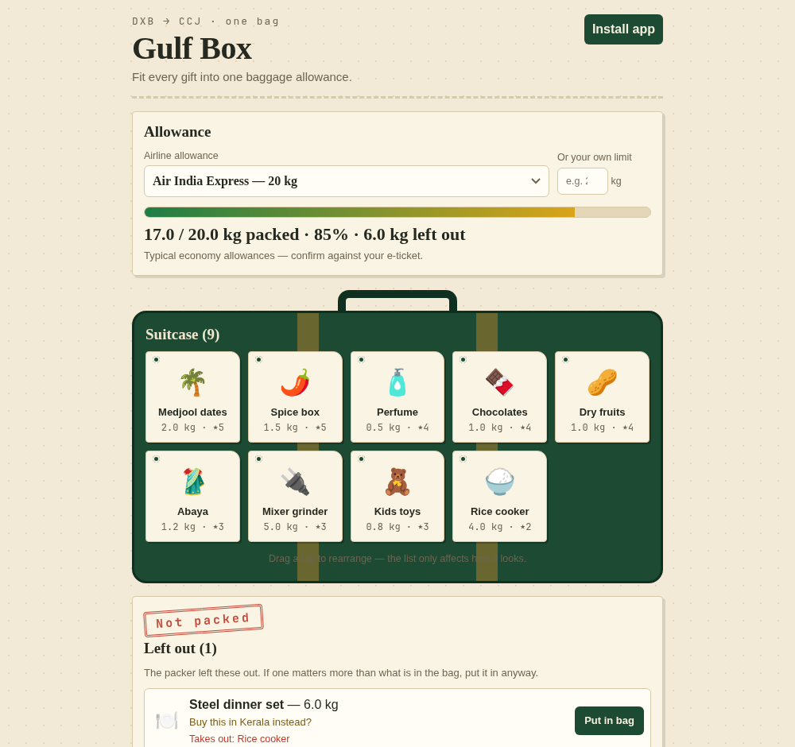

# Gulf Box

**Fit every gift into one baggage allowance.**



Built in one night at [LAYOVER 2026](https://tinkerhub.github.io/layover/) — TinkerSpace
Calicut, 10–11 Oct 2026. Theme: travel. Solo, ~11 hours.

---

## The problem

Flying home from Dubai means carrying gifts. Dates for Amma, perfume for the
cousin, a rice cooker for the uncle. The list is always 23 kilos of gifts
against a 20 kilo allowance — and you find out at the check-in counter, in
front of everyone, choosing who gets nothing.

Existing packing apps are checklists with pictures. They never show you the
bag, never optimise the choice, and never let you disagree with them.

## What it does

- **Photograph** every gift, set its weight and how much it matters (★1–5).
- **Pack** — a knapsack solver picks the highest-value set that fits the
  airline's allowance. Eight airlines built in, or type your ticket's number.
- **See the bag fill** as luggage tags you can drag into any order, with a
  live weight bar.
- **Override it** — *"Put in bag"* pins anything the packer cut and tells you
  what it would evict. The app does the arithmetic; you make the call.
- **Works offline.** Installable PWA, no network calls, no accounts, photos
  never leave the device.

## Run it

```bash
cd gulf-box
npm install
npm run dev            # http://localhost:5173
```

To see the built app — what judges see:

```bash
npm run build
npm run preview        # http://localhost:4173
```

Or open `site/index.html` — the committed production build, no install needed.

## How it works

`gulf-box/src/knapsack.ts`, about forty lines:

- Weights convert to integer **100 g units**.
- Value is `importance × 100_000 − weight`, so importance dominates and ties
  break toward the **lighter** set.
- A 0/1 DP table fills the bag, then backtracks to split packed from left out.
- Gifts you pin are pulled out first; the solver refills whatever room is left.
- Over-limit pins still show honestly in red rather than silently failing.

60 gifts re-pack in ~3 ms. No dependencies at runtime, no framework, no CDN —
which is why it works in airplane mode.

## Stack

Vite · TypeScript · vanilla DOM · `vite-plugin-pwa`. One dev dependency tree,
zero runtime dependencies.

```
gulf-box/src/     768 lines — data.ts · knapsack.ts · main.ts · style.css
site/             the built app, opens straight from the browser
assets/           screenshot
```

## Status

Feature-complete and tested: ~70 cases across four sweeps, layout audited at
seven widths from 1440 px down to 320 px.

The full PRD, technical spec, feature-by-feature test checklist, and the
60-second and 2-minute judging scripts are kept locally in `docs/` and are not
part of this published repository.

MIT